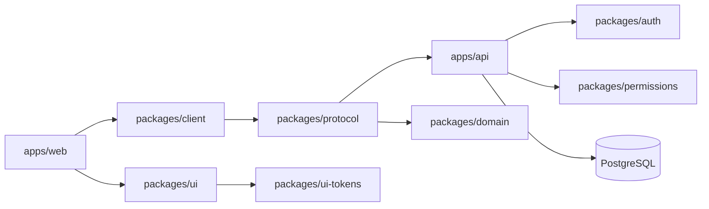

<div align="center">

# Effect App Template

Production-leaning full-stack TypeScript starter built with Effect, TanStack Start, Vite+, Better Auth, PostgreSQL, and shared shadcn/Base UI components.

[](https://github.com/shekohex/tanstack-start-effect-template/actions/workflows/ci.yml)
[](https://effect.website)
[](LICENSE)

[](https://github.com/new?template_name=tanstack-start-effect-template&template_owner=shekohex)

</div>

## Why This Template

Most starters stop at rendering a page. This template includes one working organization-membership vertical slice across schema, authorization, RPC/HTTP, database, authentication, client state, UI, migrations, and tests. Replace that domain while keeping proven boundaries and tooling.

| Area          | Included                                                                    |
| ------------- | --------------------------------------------------------------------------- |
| Runtime       | Effect v4, typed services, layers, errors, configuration, and observability |
| Web           | TanStack Start, React 19, Effect Atom, Tailwind CSS 4                       |
| API           | Effect RPC, HttpApi, OpenAPI, PostgreSQL, forward-only SQL migrations       |
| Identity      | Better Auth, session restoration, registration, login, logout               |
| Authorization | Pure deny-by-default organization membership decisions                      |
| UI            | Shared shadcn/Base UI primitives, semantic tokens, dark mode, Storybook     |
| Quality       | Vite+ checks, unit/integration/E2E/a11y/visual tests, Lefthook              |
| Agent support | Layered `AGENTS.md`, Effect/shadcn skills, vendored Effect source           |

## Architecture



Public contracts flow through `domain` and `protocol`; apps do not import implementation internals from other apps. See [`docs/architecture.md`](docs/architecture.md).

## Create A Project

1. Click **Use this template** above and create a repository.
2. Clone the generated repository.
3. Install dependencies and initialize project identity:

```bash
vp install
pnpm template:init --name my-app --scope @my-org --env-prefix MY_APP
```

Initializer updates package names, environment variables, service/database/cookie defaults, CLI binary, Compose identifiers, web metadata, and visible application name. It validates inputs before editing and refuses repeated initialization.

4. Start local infrastructure and applications:

```bash
cp .env.example .env
pnpm exec vp run setup
pnpm exec vp run dev
```

| Service          | URL                                  |
| ---------------- | ------------------------------------ |
| Web application  | <http://localhost:3000>              |
| API              | <http://localhost:4100>              |
| OpenAPI document | <http://localhost:4100/openapi.json> |
| Storybook        | <http://localhost:6006>              |

Requirements: Node.js 24+, pnpm 11+, Docker with Compose, and [Vite+](https://viteplus.dev/guide/).

## Workspace

```text
apps/
  api/              Effect runtime, services, handlers, migrations
  web/              TanStack Start application and Effect Atom state
  cli/              Public-client extension point
packages/
  auth/             Better Auth and Effect SQL adapter
  client/           Protocol-derived application client
  config/           Validated runtime configuration
  domain/           JSON-compatible domain schemas and invariants
  observability/    Optional telemetry layers
  permissions/      Pure authorization decisions
  protocol/         RPC, HTTP, OpenAPI, and wire contracts
  testkit/          Deterministic test helpers
  ui/               Shared primitives and composites
  ui-tokens/        Semantic design tokens
deploy/
  compose/          Local PostgreSQL
  migrations/       Ordered forward-only SQL migrations
```

## Commands

| Command                              | Purpose                                               |
| ------------------------------------ | ----------------------------------------------------- |
| `pnpm exec vp run dev`               | Start API and web development servers                 |
| `pnpm exec vp run setup`             | Start PostgreSQL and apply migrations                 |
| `pnpm exec vp run dev:services:down` | Stop local PostgreSQL                                 |
| `pnpm exec vp run @app/ui#storybook` | Start component workshop                              |
| `pnpm exec vp check`                 | Format, lint, and type-check                          |
| `pnpm exec vp test --run`            | Run unit and Storybook interaction/a11y tests         |
| `pnpm exec vp run integration:test`  | Run PostgreSQL integration tests                      |
| `pnpm exec vp run e2e:test`          | Run browser application flow                          |
| `pnpm exec vp run visual:test`       | Compare Storybook visual baselines                    |
| `pnpm exec vp run db:test`           | Verify migrations and database invariants             |
| `pnpm exec vp run build`             | Build apps, packages, and Storybook                   |
| `pnpm ci:local`                      | Run complete gate on isolated PostgreSQL port `55432` |

## Effect Development

All `effect` and `@effect/*` dependencies use one pnpm catalog entry in `pnpm-workspace.yaml`. The current upstream source is available at `.repos/effect` for API, implementation, and test research.

Update the source snapshot with:

```bash
git subtree pull \
  --prefix=.repos/effect \
  https://github.com/Effect-TS/effect.git \
  main \
  --squash
git rm --ignore-unmatch .repos/effect/pnpm-lock.yaml
```

The upstream lockfile is intentionally omitted so GitHub dependency scanning stays scoped to template dependencies. Agents must load `.agents/skills/effect-ts/SKILL.md`, read `.repos/effect/LLMS.md`, and follow the nearest workspace `AGENTS.md` before changing Effect code.

## Local Signoff

This repository supports [`basecamp/gh-signoff`](https://github.com/basecamp/gh-signoff) for local CI commit statuses.

```bash
# Once, after publishing a generated repository
pnpm signoff:setup

# For each clean, pushed commit
pnpm signoff
```

`pnpm signoff` runs the complete local gate, then publishes `signoff/ci`. Run setup before adding other branch-protection rules because `gh signoff install` configures branch protection.

## Documentation

- [`docs/customization.md`](docs/customization.md): identity replacement and domain customization
- [`docs/authentication.md`](docs/authentication.md): authentication boundaries and flows
- [`docs/migrations.md`](docs/migrations.md): migration lifecycle and database invariants
- [`docs/ai-agents.md`](docs/ai-agents.md): repository guidance for coding agents
- [`CONTRIBUTING.md`](CONTRIBUTING.md): contribution and validation workflow
- [`SECURITY.md`](SECURITY.md): private vulnerability reporting

Licensed under [`AGPL-3.0-only`](LICENSE).
