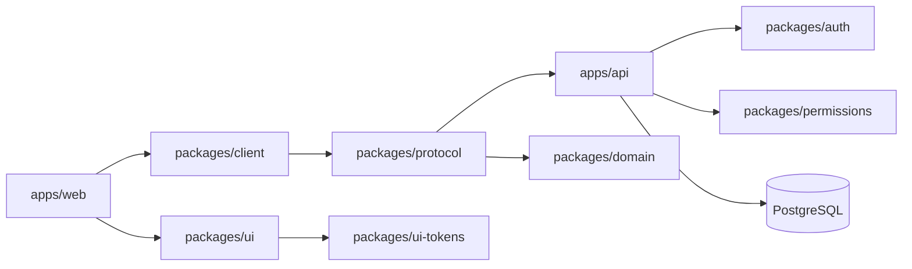

# Architecture

## Data Flow

## Boundaries

- `packages/domain`: JSON-compatible `User`, `Session`, `Organization`, `Membership`, and `Invitation` models. Pure invariants only.
- `packages/protocol`: versioned Effect Schema contracts, RPC declarations, HttpApi, middleware contracts, JSON Schema, and OpenAPI.
- `packages/client`: protocol-derived browser/server clients. No API implementation imports.
- `packages/auth`: Better Auth, Effect SQL adapter, password hashing, token helpers, typed errors.
- `packages/permissions`: pure deny-by-default authorization.
- `packages/config`: validated `APP_*` configuration and deterministic development defaults.
- `packages/observability`: optional OTLP layers.
- `packages/testkit`: deterministic clocks and identifiers.
- `packages/ui`: shared primitives and reusable composites.
- `apps/api`: runtime composition, SQL workflows, handlers, migrations.
- `apps/web`: TanStack Start, Effect Atom state, same-origin API proxy.
- `apps/cli`: compile-valid public client extension point.

Future apps, including mobile clients, should depend on domain, protocol, client, and UI boundaries instead of API implementation files.
